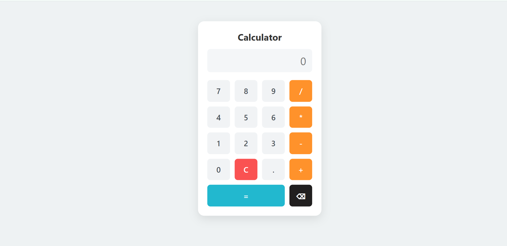

# Interactive Calculator

A responsive calculator built with HTML, CSS, and vanilla JavaScript. This project focuses on DOM manipulation, event handling, input validation, arithmetic operations, and keyboard accessibility.


## Preview




## Features

- Basic arithmetic: addition, subtraction, multiplication, and division
- Decimal and negative number support
- Operator precedence
- Clear and Backspace buttons
- Keyboard support for numbers, operators, Enter, `=`, Backspace, and Escape
- Input validation and division-by-zero handling
- Responsive layout for smaller screens
- Keyboard-visible focus indicators

## Technologies Used

- HTML5
- CSS3
- JavaScript (Vanilla)

## Getting Started

1. Download or clone this repository.
2. Open the project folder.
3. Open `index.html` in your web browser.
4. Start calculating.

No additional packages or build tools are required.

## Project Structure

```text
calculator/
├── index.html
├── styles.css
├── script.js
├── README.md
└── screenshots/
    └── calculator-ui.png
```

## What I Learned

- Creating and updating DOM elements with JavaScript
- Using arrays of objects to generate buttons dynamically
- Handling events through event delegation
- Validating calculator input
- Parsing arithmetic expressions and applying operator precedence
- Supporting keyboard interactions
- Building responsive layouts with CSS Grid and media queries
- Improving accessibility with visible focus indicators

## Future Improvements

- Add calculation history
- Add a theme switcher
- Improve automated test coverage

## Author

Developed as a hands-on project to practice frontend web development.